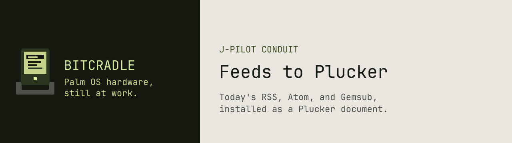
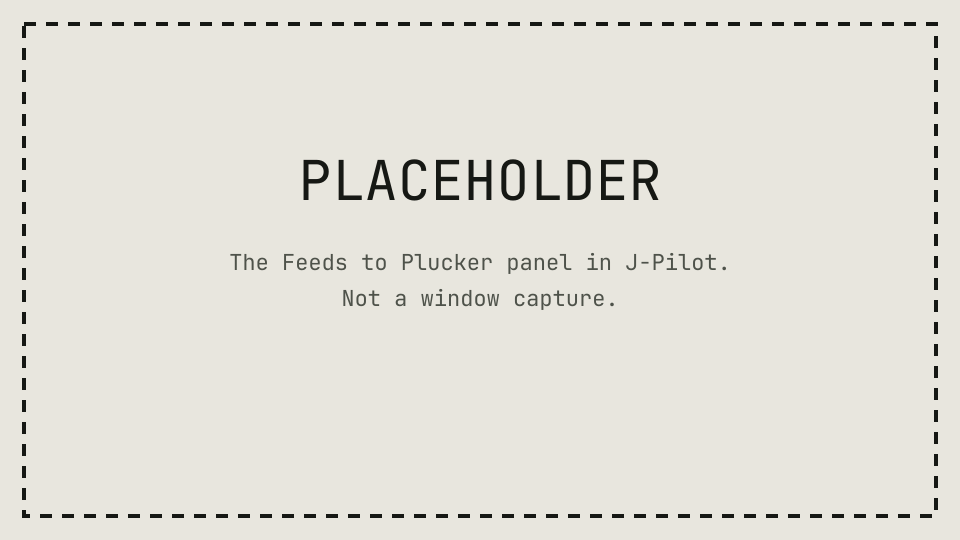
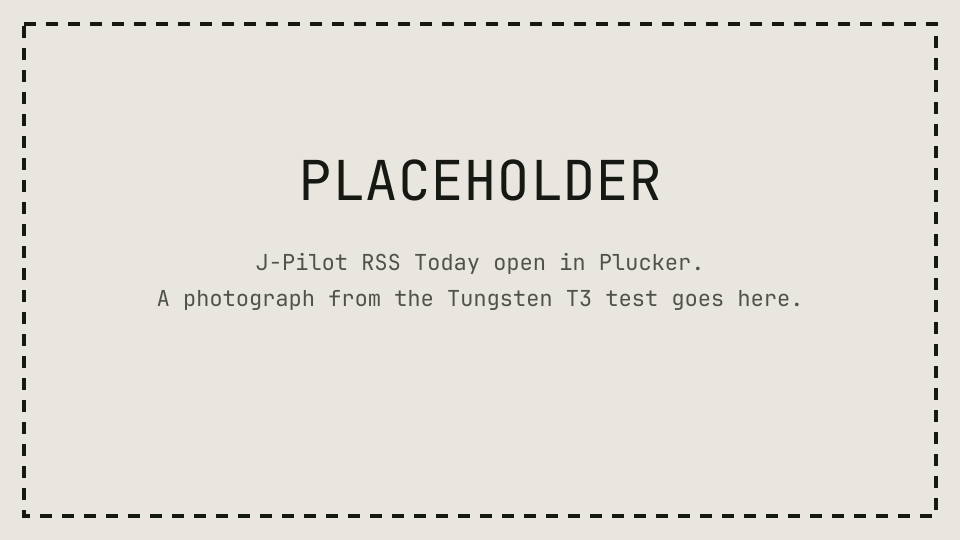

# VersaMail Conduit

[](brand/README.md)
[](brand/README.md)
[](brand/README.md)
[](LICENSE)



During HotSync, VersaMail Conduit synchronizes desktop IMAP and SMTP mail with VersaMail databases on Palm OS handhelds.

A [Bitcradle](brand/README.md) project. Palm OS hardware, still at work.

## Pitch

The conduit is a J-Pilot plugin. It syncs an IMAP Inbox and SMTP Outbox during J-Pilot HotSync with the MultiMail databases used by VersaMail 2.6.1 on Palm OS. You configure your IMAP and SMTP accounts in J-Pilot, run a HotSync, and read or draft mail on the handheld with the cable unplugged.

The running conduit does not call a language model. It talks standard IMAP and SMTP over TLS/STARTTLS directly with your mail servers. A model was used to assist in developing the conduit and reverse-engineering the database structures. That is covered under [How this was made](#how-this-was-made).

## Screenshots

No J-Pilot window capture and no handheld photograph are checked in. The frames below are placeholders.



> **Placeholder.** The J-Pilot panel (**Plugins → VersaMail**) belongs here. This is not a capture.



> **Placeholder.** A photograph of VersaMail open on a Palm device belongs here. This frame is not that photograph.

## Features

- J-Pilot plugin named **VersaMail Conduit** (version string **VersaMail Conduit 0.1.0**).
- Synchronizes Palm OS VersaMail 2.6.1 `MultiMail` databases (`Messages`, `Disconnected`, `Attachments`, `Part Plus`).
- **IMAP inbox sync**: fetches messages using verified implicit TLS (port 993) or STARTTLS on port 143. Uses read-only selection and `BODY.PEEK`.
- **Configurable fetch window**: fetches messages received today and the previous six calendar days by default, with configurable day window and optional **Fetch unread only** setting.
- **Duplicate prevention**: UIDVALIDITY-scoped import history prevents repeat delivery after Palm deletion. Leaves mail on the server.
- **Palm-formatted text**: converts HTML email bodies to plain-text formatted for Palm screens, capped at the account size limit and 47,000 bytes to leave room for headers.
- **SMTP outbox delivery**: implicit TLS on port 465 and STARTTLS on port 587/25. Handles To, Cc, and Bcc envelope recipients, including the handheld account's Bcc copy.
- **Sent folder preservation**: on SMTP acceptance, moves the original Palm record from Outbox to Sent, preserving its unique ID and payload bytes.
- **Safe delivery tracking**: SQLite delivery log records ambiguous attempts as `pending` to prevent accidental re-transmission. Manual reconciliation permitted via database state.
- **Account management UI**: GTK 3 account editor (**Plugins → VersaMail → Manage VersaMail accounts**) storing desktop credentials securely in a private profile SQLite database (`versamail.sqlite`).

## Supported devices

**Handheld.** Palm OS devices running VersaMail 2.6.1 with database creator `asc3` and database format version 0x0950 (such as the Palm Tungsten E and related Palm OS 5 handhelds). Handheld transport, live preference writes, and on-device folder changes still require acceptance testing on a physical Palm.

**Desktop.** A Unix machine running a GTK 3 build of J-Pilot with plugin support. Building requires a C compiler, `make`, `pkg-config`, GTK 3 development headers, and pilot-link development headers (`libpisock`). Running requires Python 3.11 or later and GTK 3 PyGObject bindings.

## Install

Install build and runtime dependencies on your system (e.g. on Omarchy / Arch Linux: `jpilot`, `pilot-link`, `gtk3`, `python-gobject`):

```sh
make
python3 -m unittest -v
make install
```

`make install` installs `libjpilot-versamail.so` into the active J-Pilot user profile plugin directory (`~/.jpilot/plugins/`).

## Usage

1. Restart J-Pilot after running `make install`.
2. Enable the VersaMail plugin for synchronization in J-Pilot preferences.
3. Run one HotSync to discover the handheld’s account slots.
4. Open **Plugins → VersaMail** and click **Manage VersaMail accounts**.
5. Select an existing IMAP account or an **Add account** slot, enter the desktop mail password and server settings, and save.
6. Run HotSync again to transfer edits and mail.

### Synchronization & Conflict Handling

- **Account slots**: **Delete account** queues removal of the account name and settings for the next sync. The editor leaves the built-in non-IMAP account out of the list. Use one J-Pilot profile per handheld.
- **Preferences**: The conduit compares the desktop settings, last synchronized settings, and current handheld preferences. Conflicting edits produce a sync log message. To accept the Palm edit, restore the edited desktop fields to their prior values and sync again.
- **Credential storage**: The account editor stores settings and mail passwords in the profile’s private `versamail.sqlite` file. The password, fetch window, fetch-unread choice, and SMTP authentication choice are desktop settings. The conduit preserves the Palm’s encoded password on ordinary edits. Enter passwords separately on each device.
- **Delivery recovery**: If delivery was interrupted after SMTP submission started, the conduit leaves the message in Outbox and reports the record ID. The SQLite delivery table records ambiguous attempts as `pending`. After confirming delivery on the server, changing that row to `sent` permits the Palm move on the next sync.

## Database format

The four supplied files use big-endian Palm record database headers. The on-device names contain spaces where the filenames contain plus signs. Creator is `asc3`. In the 78-byte header, offsets 52 and 56 hold the app-info and sort-info offsets, 60 and 64 the type and creator, and 76 the 16-bit record count. Each directory entry has a four-byte record offset, one attribute/category byte and a three-byte unique ID. The low nibble selects the folder. Reference: [Palm OS Programmer’s Companion, Files and Databases](https://palm.wiki/development/docs/601/PalmOSCompanion/FilesAndDatabases.html).

| Database | Type | Records in sample |
|---|---|---:|
| MultiMail Messages | Dat5 | 3 |
| MultiMail Disconnected | Dat6 | 0 |
| MultiMail Attachments | Dat7 | 0 |
| MultiMail Part Plus | Dat8 | 0 |

The Messages header version is 0x0950. Its 278-byte app-info begins at 0x68. It contains a category mask, sixteen 16-byte category labels, category IDs and trailing metadata. The first five labels are Inbox, Outbox, Drafts, Sent and Trash (indices 0–4). The other databases are 358 bytes each, with no record payloads from which to infer attachment or operation formats.

| File offset | Record ID | Attribute byte | Account number | Subject | Folder |
|---|---|---|---:|---|---|
| 0x017e | f21003 | 42 hex | 2 | Dd1 | Drafts |
| 0x01cf | f21002 | 41 hex | 2 | Hi test | Outbox |
| 0x023c | f21001 | 40 hex | 1 | Welcome | Inbox |

### Message record

The 24-byte prefix agrees with the installed pilot-link `pi-versamail.h` and its `unpack_VersaMail` implementation. The pilot-link developer also described the VersaMail conduit work in the [MultiSync developers’ discussion](https://www.mail-archive.com/multisync-users%40lists.sourceforge.net/msg01489.html).

| Offset | Size | Interpretation |
|---:|---:|---|
| 0 | 4 | IMAP UID, zero in all three samples |
| 4 | 4 | Palm timestamp in seconds from 1904 |
| 8 | 2 | pilot-link category field, 0 for Welcome, 1 for both account-2 records. Folder selection uses the directory category. |
| 10 | 2 | One-based account number |
| 12 | 2 | Unknown, zero |
| 14 | 1 | Download field, zero |
| 15 | 1 | Mark field, 2 |
| 16 | 2 | Unknown, zero |
| 18 | 1 | Reserved, zero |
| 19 | 1 | Flags including read state, 1 in the samples |
| 20 | 4 | Message size, 81, 109 and 561 respectively |

Nine consecutive NUL-terminated byte strings follow in this order: message UID string, To, From, Cc, Bcc, Subject, date string, Body and Reply-To. Empty fields take one zero byte. The samples use ASCII and LF newlines. The conduit uses Windows-1252 for Palm text. Additional bytes after Reply-To have no verified interpretation here.

The Welcome body starts with HTML markup and renders as “Welcome to VersaMail”. Its sender is `Support@palm.com`. The Outbox record contains all three supplied recipients and the body `119abz\n\nSig123`. The draft contains `1@z.com` and `Out\n\nSig123`. Both store `repy@reply.com` as Reply-To, a spelling difference from the supplied description.

### Account preferences

The PDBs contain account references. A matching local Saved Preferences resource database provided the server settings. Its resources have type `asc3` and a two-byte version 0x0950 before the payload. DLP transfers that version separately. Resources 0–7 each contain a 180-byte slot settings block. Resources 160–167 contain per-slot category data. Slot 0 is VersaMail, slot 1 is the supplied IMAP account. The conduit infers repeated string IDs from the 19-ID spacing of the two account names.

| Value | Slot 1 preference ID |
|---|---:|
| SMTP server, email, display name, signature | 29, 30, 31, 32 |
| IMAP server, account name, username, encoded password | 34, 35, 36, 37 |
| Reply-To, automatic Bcc | 39, 351 |
| Additional login and encoded password | 401, 411 |

The slot-1 settings block contains 1 at offset 0 (16-bit IMAP selector), 993 at offset 4, 5 at offset 6 and 25 at offset 32 (all 16-bit). Byte 30 is 1 in the TLS account and 0 in the default slot. The given configuration described port 143. The backup records 993. Remaining flag meanings, including which Palm bytes control unread-only, ESMTP and server deletion, require comparison captures with individual options toggled. For the supplied test password `pass`, both preference 37 and preference 411 contain the same NUL-terminated Base64 string, `xP2cHlAAhJmxr0CDklB7Ew==`. Decoding it yields 16 bytes, `c4fd9c1e50008499b1af408392507b13`. Palm documents AES-128 for account passwords in VersaMail 2.6. The 2.6.1 sample length is consistent with one AES block ([Palm Tungsten E Handbook, p. 133](https://images-na.ssl-images-amazon.com/images/I/B1U5bpf%2BYGS.pdf)).

For the known sample, literal bytes, Base64, MD4, MD5 and the first 16 bytes of SHA-1 all failed to reproduce the decoded value. The comparisons covered ASCII and both UTF-16 byte orders, each with no terminator, NUL, LF and CRLF. A single AES-128 block under an all-zero key also failed for each encoding with zero padding, PKCS#7 padding, and a one-byte byte-length prefix followed by zero padding. The key source, mode and plaintext layout remain unknown. Equality between the two resources is also consistent with copying the stored value between preferences.

## Verification

The test suite (`python3 -m unittest -v`) verifies:
- Reading the original Messages PDB and parsing directory entries and app-info blocks.
- SMTP envelope handling, recipient routing, and retry logic after acceptance.
- Verifying the move preserves the original Outbox payload and record ID.
- HTML to Palm plain-text conversion.
- Mocked IMAP fetch operations and duplicate prevention using UID history.

Network services are mocked. The decoded preferences were separately checked against matching local backups.

## How this was made

This conduit was developed with the assistance of large language models. The code, test suite, reverse-engineering analyses, and brand kit were developed with model prompts, reviewed by a human, and validated against sample Palm databases and unit tests.

The running conduit does not call any model. It runs entirely on the desktop using standard Python libraries, pilot-link, and SQLite.

## Roadmap

The items below are planned. They are not in the tree yet.

- Acceptance testing with a physical Palm OS handheld over USB/serial HotSync.
- Attachment database handling (`MultiMail Attachments`).
- Reverse-engineer the Palm on-device password encryption key/seed to allow writing handheld passwords from desktop.
- Support for custom mail folder synchronization beyond Inbox/Outbox/Sent.

## Contributing

See [CONTRIBUTING.md](CONTRIBUTING.md).

## License

VersaMail Conduit is free software. You can redistribute it and modify it under the terms of the GNU General Public License as published by the Free Software Foundation, either version 2 of the License, or (at your option) any later version. See [LICENSE](LICENSE).

## References

- [Palm OS Programmer’s Companion, Files and Databases](https://palm.wiki/development/docs/601/PalmOSCompanion/FilesAndDatabases.html)
- [pilot-link pi-versamail header](https://github.com/j-pilot/pilot-link)
- [J-Pilot plugin guide](https://www.jpilot.org/documentation/plugin.html)
- [MultiSync developers discussion](https://www.mail-archive.com/multisync-users%40lists.sourceforge.net/msg01489.html)
- [Palm Tungsten E Handbook](https://images-na.ssl-images-amazon.com/images/I/B1U5bpf%2BYGS.pdf)

---

Part of **Bitcradle**. Palm OS hardware, still at work.

Colors, type, and marks: [brand/README.md](brand/README.md). Copy that folder into another Palm OS project to reuse it.